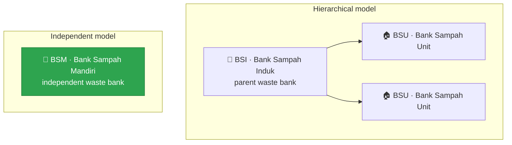
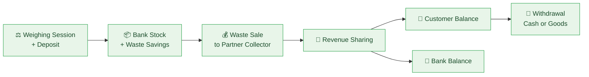
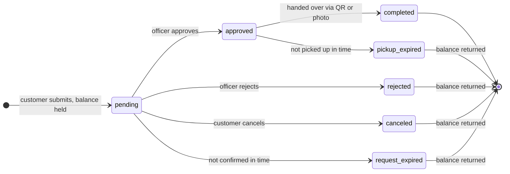

# ♻️ Digital Waste Bank with Multi-Level Hierarchy Support (BSI, BSU, BSM)

**Turning household waste into savings — from the scale to the customer's wallet.**

---

## 🌍 About

This backend powers a digital waste bank platform that digitizes the whole waste bank cycle: weighing customers' waste, selling it to partner collectors, sharing the revenue back to customers, and serving their withdrawals.

The platform supports a **multi-level waste bank hierarchy**:

> [!NOTE]
> This README focuses on the **BSM (Bank Sampah Mandiri)** features, the first level to reach its final state.

---

## 🚦 Project Status

| Level | Description | Status |
| :---: | --- | :---: |
| **BSM** | Bank Sampah Mandiri: independent waste bank | ✅ **Final** |
| **BSI** | Bank Sampah Induk: parent waste bank | 🚧 In development |
| **BSU** | Bank Sampah Unit: unit waste bank under a BSI | 🚧 In development |

---

## 🔄 Core Business Processes

Four processes form one continuous cycle, from the moment waste is weighed to the moment the customer collects their reward.

### 1. ⚖️ Weighing Session (with Deposit sub-process)

*Scheduled sessions where customers (**nasabah**) bring their waste to be weighed and recorded.*

- **Sessions are created automatically.** Starting at 20:00 on the day before each scheduled weighing, the system prepares a `pending` session.
- **Officers (petugas) control the session lifecycle:** they open it (`pending` → `aktif`), close it (`aktif` → `selesai`), or cancel it with a stated reason (`dibatalkan`).
- **Self-cleaning:** sessions that were never opened are cancelled automatically, and active sessions left open past their schedule are closed automatically.
- **Customers and staff are notified** when a session is coming up, opened, closed, or cancelled.

**↳ Deposit sub-process**

1. The officer scans the customer's **QR code** to verify their membership.
2. The officer enters the weighed items from the bank's waste catalog and **previews** the result before saving.
3. On submit, the **bank's waste stock** grows and the deposit is recorded in the customer's **waste savings** (*tabungan sampah*).
4. The customer receives a **deposit notification**.

> [!IMPORTANT]
> Guard rails: a deposit is rejected if the bank no longer accepts that incentive type, and an officer can never record a deposit on their own customer account.

### 2. 💰 Waste Sales

*The bank sells its collected waste stock to partner collectors (**mitra pengepul**).*

- Sales are grouped by **incentive type**: **Cash** (Rp) or **Goods** (points).
- Officers choose an existing partner collector or register a new one on the spot.
- Each sale goes through **preview → submit**, with a **photo as proof** of the transaction.
- Bank stock is reduced, and every selling price change is kept in the **price history**.
- The customer's share price is **snapshotted** at the time of sale (`selling price × bank's sharing percentage`), so later percentage changes never affect past sales.

### 3. 🤝 Revenue Sharing

*Sale proceeds are distributed back to the customers whose waste was sold.*

- The sold quantity is drawn from customers' waste savings **oldest first (FIFO)**, so the earliest deposits are settled first.
- Each customer receives `quantity sold × customer share price`, credited directly to their **balance**.
- The remainder (`gross sale − total distributed`) goes to the **bank's balance**.
- A **preview** shows the full breakdown before anything is committed.
- Each sale can be shared **exactly once**, and every recipient gets a **notification**.

### 4. 🏧 Withdrawal

*Customers turn their balance into cash, or exchange their points for goods from the bank's catalog.*

- The customer submits a request (with a preview first). The amount is **held from their balance immediately**, so it cannot be spent twice.
- An officer **approves** the request with a pickup deadline, or **rejects** it with a mandatory note.
- The handover is completed by **scanning the customer's QR code**, or with a **photo proof + note**.
- Expired requests are handled automatically, and the held balance and goods stock are **always returned** when a request does not complete.

---

## 🧰 Supporting Features

<table>
  <tr>
    <td width="50%" valign="top">
      <h3>🗂️ Waste & Goods Catalog Management</h3>
      Each bank manages its own <b>waste catalog</b> (price and incentive type per item) and <b>goods catalog</b> (point price and stock) that customers can redeem through withdrawals. Every waste item keeps its own price history.
    </td>
    <td width="50%" valign="top">
      <h3>📅 Schedule Management</h3>
      Define <b>recurring schedules</b> (a day of the week on the n-th week of the month) or <b>special one-off schedules</b>, individually or in batches. Schedules drive the automatic creation of weighing sessions.
    </td>
  </tr>
  <tr>
    <td width="50%" valign="top">
      <h3>📊 Customizable Revenue-Sharing Percentage</h3>
      Each bank sets its own <b>customer share percentage</b> per incentive type (Cash / Goods), with a full <b>change history</b>. A disabled incentive type stops accepting new deposits, but existing balances are still served.
    </td>
    <td width="50%" valign="top">
      <h3>💳 Bank Mutation & Customer Balance Monitoring</h3>
      A complete <b>bank balance mutation log</b>, including manual credit/debit entries, alongside each <b>customer's balance and mutation history</b>, plus the total and per-customer list of all balances.
    </td>
  </tr>
  <tr>
    <td width="50%" valign="top">
      <h3>📈 Dashboard</h3>
      At-a-glance summaries for officers and an overview of the <b>bank's balance</b>, so daily operations can be monitored from one place.
    </td>
    <td width="50%" valign="top">
      <h3>🧾 Reporting & Archiving</h3>
      Downloadable <b>Excel reports</b> for weighing, sales, revenue sharing, withdrawals, customers, and catalogs, both <b>per transaction</b> and as <b>period recaps</b>.
    </td>
  </tr>
</table>

---

  ♻️ Every kilogram counts. Built for a cleaner, more rewarding way to manage waste. 🌱

